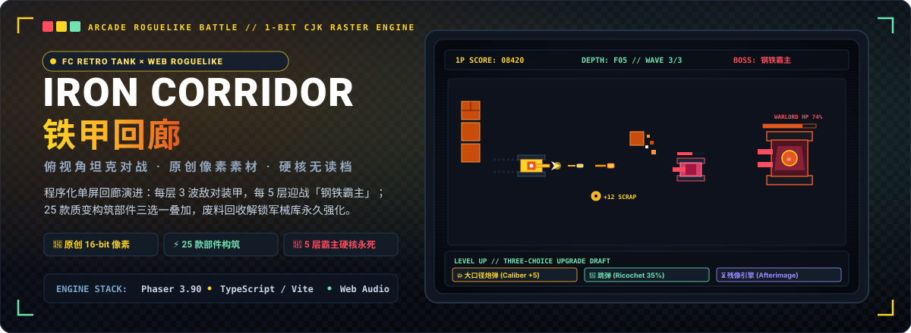
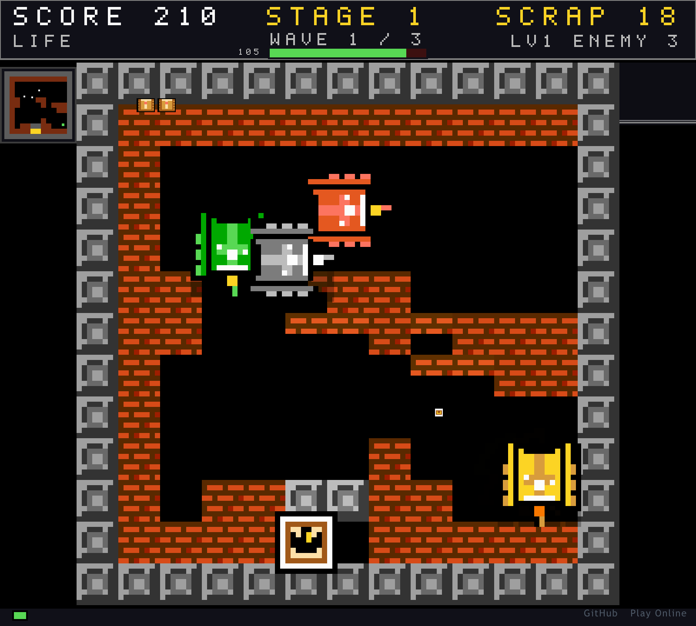
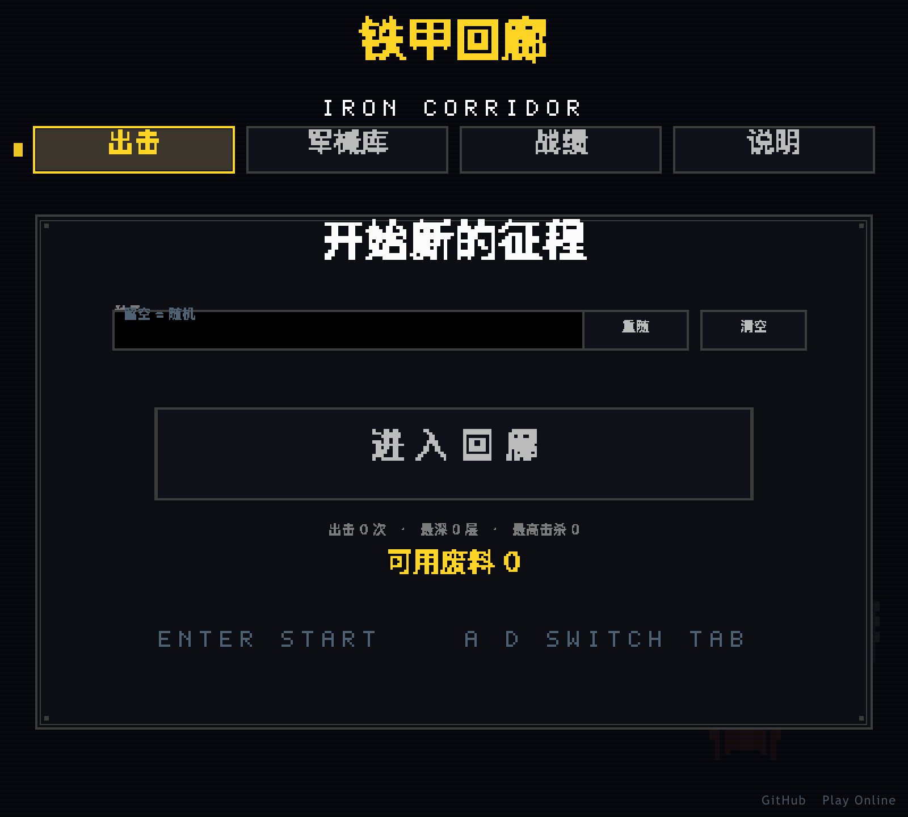

<p align="right"><a href="README.md">中文</a></p>

<p align="center">
  
</p>

<p align="center">
  <a href="https://holynova.github.io/iron-corridor/">▶ Play Online</a>
  ·
  <a href="https://github.com/holynova/iron-corridor">GitHub Repository</a>
</p>

Iron Corridor is a tank-battler roguelike in the browser: classic console-style top-down tank combat with hardcore build depth. Single-screen procedurally generated corridors, 3 waves per depth, a giant boss every 5 depths, draft-one-of-three upgrades (25 stackable parts), and scrap that buys permanent arsenal upgrades. Three lives, no continues — every run starts fresh.

## Screenshots

<p align="center">
  
  
</p>

## How to Play

- **Descend**: 30 depths, each a procedurally generated single-screen corridor (brick walls, steel barriers, and cover that change every time). Clear 3 waves of enemies to descend to the next depth.
- **Bosses**: a giant boss every 5 depths — depth 5 「钢铁霸主」 (Steel Overlord, 900 HP), depth 10 「钢铁霸主 II · 重装」 (Steel Overlord II · Heavy, 1,600 HP), and from depth 20 「终焉协议 · 泰坦」 (Final Protocol · Titan, 2,800 HP) — each tier faster and deadlier.
- **Draft one of three**: after leveling up or clearing a wave, pick 1 of 3 cards. 25 parts, all stackable, in 4 rarities （普通 Common / 稀有 Rare / 史诗 Epic / 传说 Legendary).
  - **Stats**: 大口径炮弹 (Large-Caliber Shells), 快速装填 (Rapid Reload), 推进器 (Thrusters), 焊接装甲 (Welded Armor), 膛线加速 (Rifling Boost), 纳米修复 (Nano Repair), 拾荒者 (Scavenger), and more.
  - **Weapon mutations**: 分裂炮管 (Split Barrel, multi-shot), 穿甲弹 (Piercing Rounds), 高爆弹 (HE Shells, area explosion), 跳弹 (Ricochet off walls), 追踪弹头 (Homing Rounds), 暴击强化 (Crit Boost).
  - **Tactical traits**: 双段推进 (Double Dash, +1 dash), 相位护盾 (Phase Shield, longer dash i-frames), 虹吸涂层 (Siphon Coating, lifesteal on kill), 背水一战 (Last Stand, faster reload at low HP), 残像引擎 (Afterimage Engine, slow-mo on kill), 连锁反应 (Chain Reaction, crit kills detonate).
- **Arsenal**: scrap dropped in combat buys permanent upgrades in the main menu （船体 Hull / 炮管 Barrel / 装填 Loader / 引擎 Engine / 拾荒 Salvage / 修复 Repair). They survive death — you get stronger with every run.
- **Lives**: 3 lives per run; when they're gone, the run ends. Records (runs, deepest depth, most kills) are saved locally.

## Enemies

8 enemy types, with silhouettes and paint jobs following classic arcade tiers — you can read their behavior at a glance:

| Enemy | Behavior |
| :--- | :--- |
| 侦察兵 (Scout) | High-mobility flanking harassment |
| 炮手 (Gunner) | Mid-range 3-round burst suppression |
| 重装 (Heavy) | 130 HP, frontal charges |
| 狙击手 (Sniper) | Long-range ultra-fast single shots |
| 冲锋者 (Charger) | 210 px/s close-range ramming |
| 蜂群 (Swarmer) | Attacks in packs to split your attention |
| 固定炮台 (Turret) | Stationary, 96 HP, 4-round bursts |
| 钢铁霸主 (Steel Overlord) | Boss, 900+ HP, 5-round heavy volleys |

## Controls

| Action | Key |
| :--- | :--- |
| Move | W / A / S / D or arrow keys |
| Aim | Mouse |
| Fire | Left mouse button or Space |
| Dash (with i-frames) | Shift or F |
| Pause | Esc or P |

## Run Locally

Phaser 3 + TypeScript + Vite, requires Node.js:

```bash
git clone https://github.com/holynova/iron-corridor.git
cd iron-corridor
npm install
npm run dev        # Dev server, default port 5199
npm run build      # Type check + production build
npm run preview    # Preview the production build locally
```

## Tech

- Phaser 3.90 + TypeScript + Vite, WebGL rendering, Web Audio synthesized sound effects.
- All pixel art is procedurally generated in-code by `tools/gensprites.mjs` on 8×8 / 16×16 grids — no borrowed assets. Chinese UI text is rasterized with a 1-bit threshold (`PixelCjk`) sharing the same pixel grid as the English bitmap font.
- Enemy pathfinding uses flow fields; arenas are procedurally generated with reproducible seeds (enter one in the main menu).
- The palette shifts from cool to hot across the 30 depths (`DEPTH_TINT`); boss fights have a dedicated health bar and warning banner.

```
index.html              Entry (800×720 canvas)
src/main.ts             Phaser instance setup
src/scenes/             Boot / main menu / battle / draft-one-of-three / results
src/systems/            Arena generation / flow-field pathfinding / collision / run state
src/entities/           Player / enemies / bullets / drops
src/data/               Enemy stat tables / 25 upgrade definitions / font mapping
src/core/               Sound synthesis / RNG seeds / constants / saves
src/ui/                 Bitmap font / HUD / rarity badges
tools/gensprites.mjs    Pixel-grid sprite generator
```
