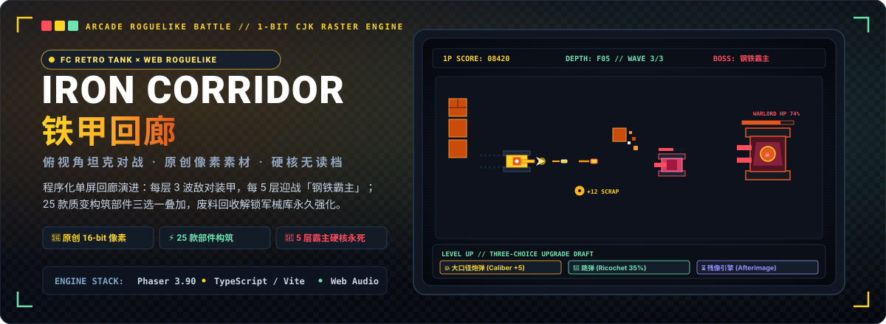
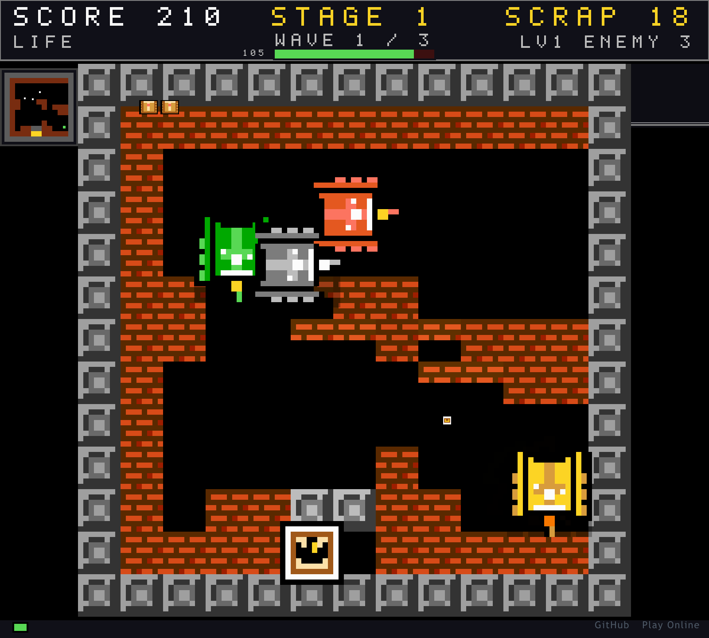
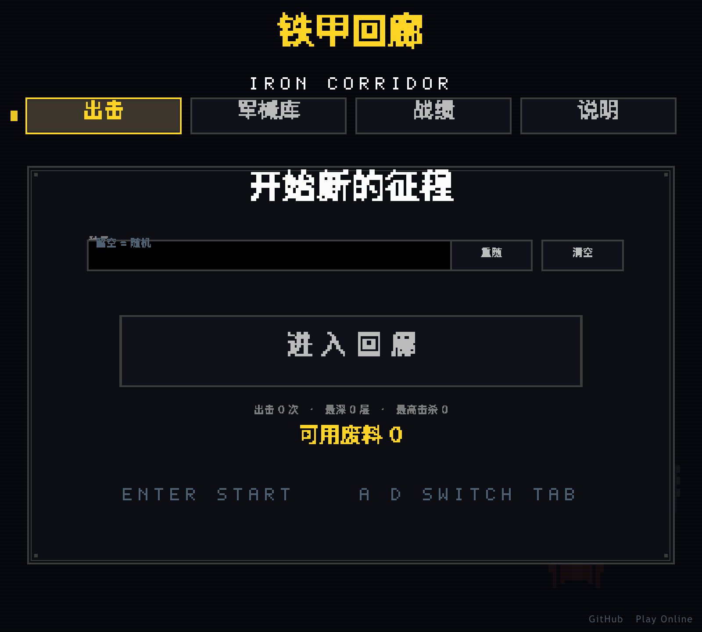

<p align="right"><a href="README.en.md">English</a></p>

<p align="center">
  
</p>

<p align="center">
  <a href="https://holynova.github.io/iron-corridor/">▶ 在线玩</a>
  ·
  <a href="https://github.com/holynova/iron-corridor">GitHub 仓库</a>
</p>

铁甲回廊是一款坦克大战 × Roguelike 网页游戏：红白机风格的俯视角坦克对战，配上硬核构筑深度。单屏程序化回廊、每层 3 波敌军、每 5 层一只巨型 Boss，升级三选一、25 种部件可叠加，废料还能换军械库永久强化。3 条命用完即宣告失败，每次出击都是全新开局。

## 截图

<p align="center">
  
  
</p>

## 玩法

- **闯关**：共 30 层，每层是程序化生成的单屏回廊（砖墙、钢壁、掩体每次都不同），清掉 3 波敌军进入下一层。
- **Boss**：每 5 层一只巨型 Boss——第 5 层「钢铁霸主」（900 HP）、第 10 层「钢铁霸主 II · 重装」（1600 HP）、第 20 层起「终焉协议 · 泰坦」（2800 HP），血量、弹速、伤害逐档跃升。
- **三选一强化**：升级或清波后从 3 张卡里选 1 张，25 种部件均可叠加，分 4 档稀有度（普通 / 稀有 / 史诗 / 传说）。
  - **属性**：大口径炮弹、快速装填、推进器、焊接装甲、膛线加速、纳米修复、拾荒者等。
  - **武器质变**：分裂炮管（多发并行）、穿甲弹（贯穿）、高爆弹（范围爆炸）、跳弹（墙体反弹）、追踪弹头、暴击强化。
  - **战术异能**：双段推进（冲刺 +1 次）、相位护盾（冲刺无敌帧延长）、虹吸涂层（击杀吸血）、背水一战（低血量加速装填）、残像引擎（击杀时滞）、连锁反应（暴击击杀殉爆）。
- **军械库**：战斗掉落的废料可在主菜单换永久强化（船体 / 炮管 / 装填 / 引擎 / 拾荒 / 修复），死后不消失，越打越强。
- **生命**：每局 3 条命，命用完即结算；战绩（出击次数、最深层数、最高击杀）保存在本地。

## 敌军图鉴

8 种敌军，剪影与涂装对应经典街机分级，一眼可判行为：

| 敌军 | 特点 |
| :--- | :--- |
| 侦察兵 | 高机动迂回游击 |
| 炮手 | 中距离 3 连发压制 |
| 重装 | 130 HP，正面冲撞 |
| 狙击手 | 远距离超高速单发 |
| 冲锋者 | 210 px/s 近身撞击 |
| 蜂群 | 成群骚扰，分散注意 |
| 固定炮台 | 不动，96 HP，4 连发 |
| 钢铁霸主 | Boss，900+ HP，5 连发重弹 |

## 操作

| 动作 | 按键 |
| :--- | :--- |
| 移动 | W / A / S / D 或方向键 |
| 瞄准 | 鼠标 |
| 开火 | 鼠标左键或空格 |
| 冲刺（带无敌帧） | Shift 或 F |
| 暂停 | Esc 或 P |

## 本地运行

Phaser 3 + TypeScript + Vite，需要 Node.js：

```bash
git clone https://github.com/holynova/iron-corridor.git
cd iron-corridor
npm install
npm run dev        # 开发服务器，默认端口 5199
npm run build      # 类型检查 + 生产构建
npm run preview    # 本地预览构建产物
```

## 技术

- Phaser 3.90 + TypeScript + Vite，WebGL 渲染，Web Audio 合成音效。
- 全部像素素材由 `tools/gensprites.mjs` 在 8×8 / 16×16 点阵上程序化生成，非外部盗用素材；中文 UI 用 1-bit 阈值栅格化（`PixelCjk`）与英文点阵共用同一像素网格。
- 敌军寻路用流场（flowfield），竞技场程序化生成，种子可复现（主菜单可填种子）。
- 30 层深度色调由冷渐热（`DEPTH_TINT`），Boss 战有专属血条与警告横幅。

```
index.html              入口（800×720 画布）
src/main.ts             Phaser 实例初始化
src/scenes/             启动 / 主菜单 / 战斗 / 三选一 / 结算
src/systems/            竞技场生成 / 流场寻路 / 碰撞 / 回合状态
src/entities/           玩家 / 敌军 / 子弹 / 掉落
src/data/               敌军属性表 / 25 种升级定义 / 字库映射
src/core/               音效合成 / RNG 种子 / 常数 / 存档
src/ui/                 点阵字体 / HUD / 稀有度徽章
tools/gensprites.mjs    像素点阵生成器
```
